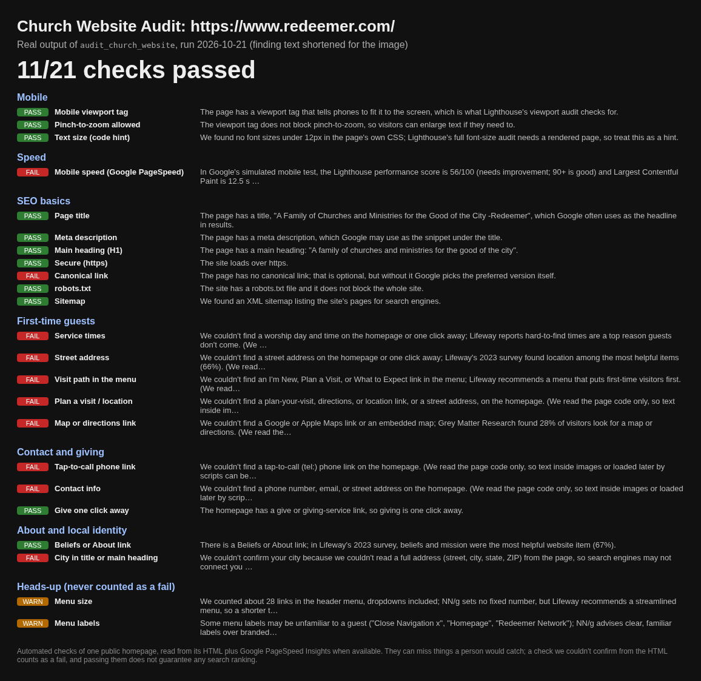

# Church Website Audit by Journey Digital

[](https://glama.ai/mcp/servers/tnvolman/jd-church-website-audit)
[](https://glama.ai/mcp/servers/tnvolman/jd-church-website-audit)
[](https://github.com/tnvolman/jd-church-website-audit/actions/workflows/ci.yml)

A free church website audit tool (an MCP server and Cursor plugin) that checks mobile, page speed, SEO basics, and whether a first-time visitor can find service times.



*Real output of `audit_church_website` for a public church homepage, run 2026-10-21. Finding text is shortened in the image; the full JSON is in [docs/example-audit-redeemer.json](docs/example-audit-redeemer.json).*

## Install

One line, from a clean checkout (Node 18+, zero dependencies). It clones the repo and runs the local self-test:

```bash
git clone https://github.com/tnvolman/jd-church-website-audit && cd jd-church-website-audit && node scripts/prove.js
```

Then point your MCP client at `server/audit-mcp.js` (see [Usage](#usage)). In Cursor, the repo also loads as a plugin through `.cursor-plugin/plugin.json`.

Prefer not to install anything? Run the same church website checker in your browser at **[journeydigital.ai/audit](https://journeydigital.ai/audit)**.

## What it checks

One MCP tool, `audit_church_website`, sends one church homepage to Journey Digital's audit and returns every check:

- **Mobile:** viewport tag, pinch-to-zoom, text size.
- **Speed:** Google PageSpeed mobile performance.
- **SEO basics:** title, meta description, H1, https, canonical link, robots.txt, sitemap.
- **First-time guests:** service times, street address, an I'm New / Plan a Visit path, map or directions.
- **Contact and giving:** tap-to-call, contact info, giving one click away.
- **About and local identity:** beliefs or about link, city in the title or main heading.
- **Heads-up notes** (never counted as a fail): menu size and menu labels.

Report the result as `passed/total` exactly as the API returns `passed` and `total`. Do not hardcode `/21` and do not recompute the counts. Each check comes with a plain-English finding and a cited source for each check. It covers church website SEO basics only and **does not guarantee any search ranking**. Things like first-screen placement and how easy the phone menu feels still need a human look.

## Usage

MCP client config (Claude Desktop, Cursor `mcp.json`, and similar):

```json
{
  "mcpServers": {
    "church-website-audit": {
      "command": "node",
      "args": ["/absolute/path/to/jd-church-website-audit/server/audit-mcp.js"]
    }
  }
}
```

Then ask your agent: *"Audit https://example-church.org with audit_church_website."*

Tool arguments:

| Argument | Required | Meaning |
| --- | --- | --- |
| `url` | yes | The church homepage to check. |
| `include_cta` | no | `false` leaves off the consultation note. Nothing else changes. |

Set `JOURNEY_DIGITAL_AUDIT_BASE_URL` to use another origin (default `https://journeydigital.ai`). There is no API key. If the audit service is unreachable or returns a malformed report, the tool returns an error; it never invents results.

### Docker

The image speaks MCP over stdio. It is `node:22-alpine`, installs nothing, and runs as the `node` user:

```bash
docker build -t jd-church-website-audit .
docker run -i --rm jd-church-website-audit
```

Point the MCP client at that command. `JOURNEY_DIGITAL_AUDIT_BASE_URL` still overrides the origin.

## Privacy

The church website address you submit is sent to journeydigital.ai, which fetches that page, and to Google PageSpeed for the speed check. Plugin audits store anonymous counts only. See the [privacy policy](https://journeydigital.ai/privacy), [terms](https://journeydigital.ai/terms) and [PRIVACY.md](PRIVACY.md).

## What is in this repo

| Path | Purpose |
| --- | --- |
| `server/audit-mcp.js` | Zero-dependency Node stdio MCP server with one tool. |
| `Dockerfile`, `.dockerignore` | Stdio image: `node:22-alpine`, no npm install, runs as `node`. |
| `glama.json` | Glama maintainer claim. The published schema has one field, `maintainers`. |
| `mcp.json`, `.cursor-plugin/plugin.json` | Cursor plugin manifest and MCP entry. |
| `skills/present-church-website-audit/SKILL.md` | How an agent should present the report. |
| `SPEC.md` | JSON contract for `POST /api/audit`. |
| `scripts/prove.js` | Self-test against a mock server (no live calls). |
| `docs/` | The example audit image and its raw JSON. |

## About

Built and published by Michael McClanahan at [Journey Digital, a small church website design studio in Wilson, NC](https://journeydigital.ai/). Questions: sales@journeydigital.ai. Not endorsed by Cursor or Grok Bot.

## Contributing

Issues and pull requests are welcome. Keep the server zero-dependency, run `node scripts/prove.js` before opening a PR, and never hardcode or recompute scores: the tool passes the API's `passed` and `total` through unchanged. Notable changes go in [CHANGELOG.md](CHANGELOG.md).

## License

[MIT](LICENSE). Copyright 2026 Michael McClanahan.
